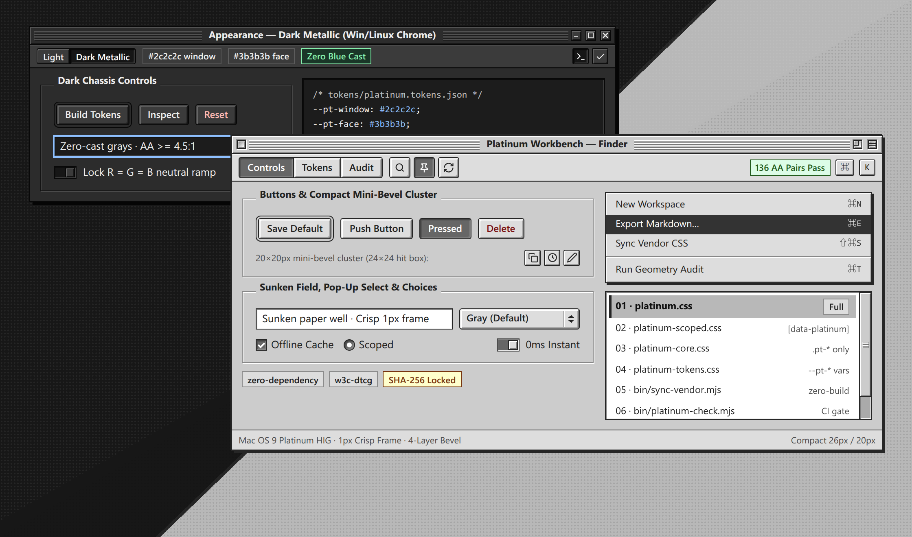
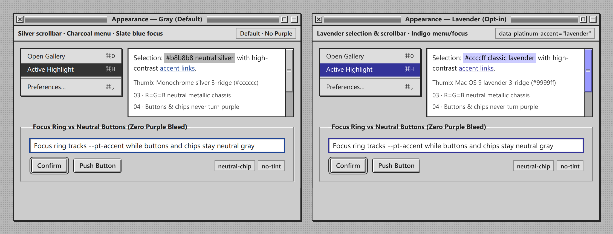
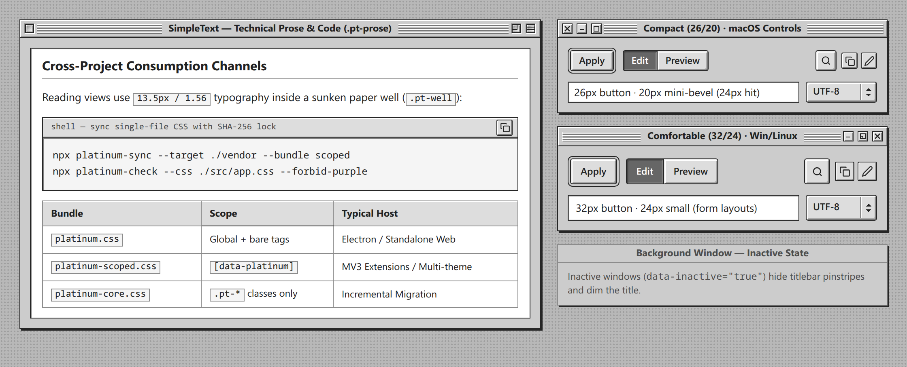

# Platinum UI

**English** | [简体中文](README.zh-CN.md) | [Live Interactive Gallery](https://pine2d.github.io/platinum-ui/)

A cross-project **Mac OS 9 Platinum** design system: W3C DTCG design tokens, zero-framework-JS modular CSS widgets, an interactive HTML gallery, reusable static and Chromium geometry/contrast gates, and a companion global AI Agent Skill.



## Highlights

- **Authentic Platinum mechanics**: Crisp `1px` borders, `2px` hard drop shadows, four-layer metallic bevels, `2px` horizontal pinstripe titlebars, `15px` three-ridge scrollbars, Mac OS 9 HIG double-arrow pop-up selects, etched groove group boxes, and instant `0ms` state transitions.
- **Zero-cast light/dark chassis and two official accent variants**: Light silver (`#cccccc`/`#dddddd`) and dark metallic grays keep strict `R=G=B` neutrality. Ships with a purple-free **`gray`** default variant (silver scrollbars, charcoal menu highlights, and slate blue focus/links) and an opt-in classic **`lavender`** variant via `data-platinum-accent="lavender"`. Every foreground/surface pair passes WCAG AA `>= 4.5:1` across all four quadrants.



- **Compact and comfortable densities, plus technical prose**: Defaults to `compact` (`26px` primary controls and `20px` mini-bevel icon buttons with `::before` `24×24px` hit areas), with opt-in `data-platinum-density="comfortable"` (`32px` / `24px`). Includes `.pt-prose`, `.pt-code-window`, and `1px` hard-bordered tables.
- **Dual consumption channels**: Bundler projects (Electron, Vite, React, TypeScript) import CSS entrypoints via package exports; zero-build projects (MV3 Chrome extensions, static HTML) run `platinum-sync` to copy a single-file CSS bundle stamped with a version and SHA-256 drift check header.



## Quick Start

### Channel A: Bundler Projects (Vite / Webpack / Electron)

Pin a release tag in `package.json` (e.g. `"platinum-ui": "github:pine2D/platinum-ui#v0.1.0"`) and import the bundle that matches your app:

```js
// 1. Full Platinum app (styles bare <button>/<input>/<select>/<fieldset> + .pt-* + .pt-prose)
import "platinum-ui/platinum.css";

// 2. Multi-theme or container-isolated mode (applies only inside [data-platinum], leaving :root untouched)
import "platinum-ui/scoped.css";

// 3. Explicit .pt-* primitives only (leaves bare HTML elements untouched)
import "platinum-ui/core.css";
```

### Channel B: Zero-Build Projects (Chrome Extensions / Static HTML)

```bash
# Copy a single-file CSS bundle into your project with a version + SHA-256 header lock
node bin/sync-vendor.mjs --target /path/to/your-app/vendor --bundle scoped

# Verify in CI or pre-commit that the synced file matches upstream without hand-edits
node bin/sync-vendor.mjs --target /path/to/your-app/vendor --bundle scoped --check
```

## Local Preview and Quality Gates

Try the [Live Interactive Gallery](https://pine2d.github.io/platinum-ui/) online or open `gallery/index.html` locally to switch between English and Chinese, light and dark modes, `Gray` and `Lavender` variants, compact and comfortable densities, and active/inactive window states.

```bash
npm run build                        # Compile dist/*.css from tokens/platinum.tokens.json + src/*.css
npm run verify                       # Run zero-drift build check + 4-quadrant AA + static CSS gates + unit tests
npm run shots                        # Regenerate 2x lossless docs/screenshots/*.webp stage renders via Chromium
node bin/platinum-check.mjs --browser               # Launch Chromium to run 8-state icon centering and hit-area probes
node bin/platinum-check.mjs --css app.css --forbid-purple   # Audit external app CSS for Platinum traps and purple leaks
```

## Global AI Agent Skill

```bash
npx skills add ./skills/platinum-ui -g -y
```

Once installed, ask Claude Code, Codex, or Antigravity to apply the `platinum-ui` specification in any project; the agent selects the matching CSS channel for your stack and runs the geometry and contrast gates.

## Repository Layout

- `tokens/platinum.tokens.json` — Single source of truth for W3C DTCG tokens
- `src/{core,elements,prose}.css` — Modular CSS source layers
- `dist/` — Zero-dependency compiled CSS bundles (do not edit by hand)
- `gallery/index.html` — Interactive static component gallery
- `scripts/readme-shots.mjs` — `2×` lossless stage screenshot generator (`docs/screenshots/`)
- `bin/{build,sync-vendor,platinum-check}.mjs` — Build, zero-build vendor sync, and automated audit CLIs
- `skills/platinum-ui/SKILL.md` — Cross-agent skill definition
- `skills/platinum-ui/references/` — Reference guides for Electron frameless windows/popup menus, `16px` pixel app icons, and CSS anti-patterns
- `DESIGN.md` — Complete visual and engineering specification

## License

MIT. See [LICENSE](LICENSE).
