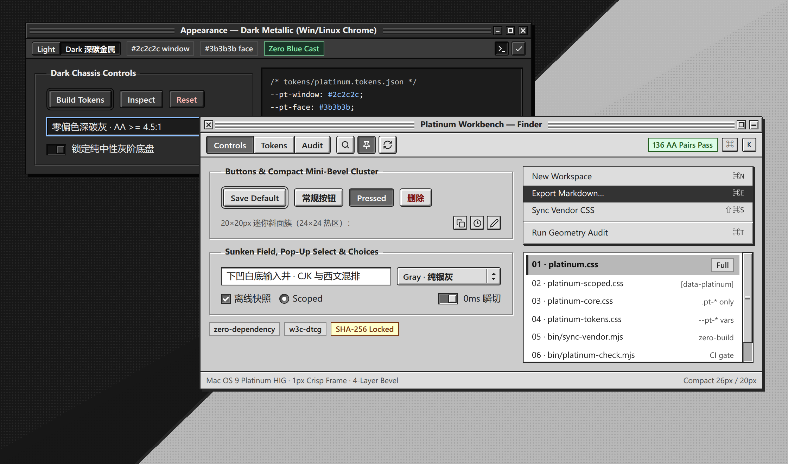
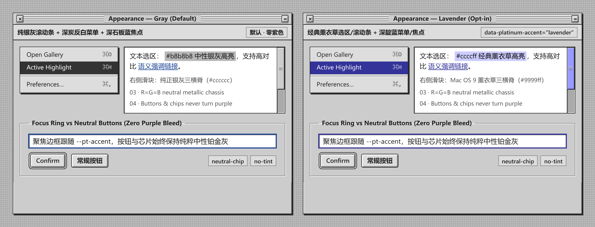
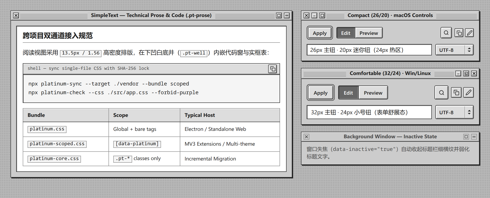

# Platinum UI

[English](README.md) | **简体中文** | [在线交互画廊](https://pine2d.github.io/platinum-ui/?lang=zh-CN)

原汁原味的 **Mac OS 9 Platinum** 跨项目设计系统：包含 W3C DTCG 设计令牌、零框架 JS 的模块化纯 CSS 部件库、交互式静态预览画廊、可复用的静态/Chromium 几何与对比度体检门禁，以及配套的全局 AI Agent Skill。



## 特性概览

- **纯正 Platinum 机械质感与跨平台窗口控制**：`1px` 利落黑框、`2px` 硬边投影、四层金属凹凸斜面、居中 `12px` 六条细横纹标题条、`15px` 四道刻纹滚动条、HIG 双箭头弹出选择框、蚀刻凹槽分组框与 `0ms` 机械瞬切。通过 `data-platinum-controls="mac9" | "macos" | "win"` 一键切换窗口按钮布局（默认 Mac OS 9 左侧空白斜面关闭框+右侧缩放/WindowShade 双横线折叠、现代 macOS 左置三连或 Win/Linux 右置三连），空按钮按预设绘制对应字形并具备 `18×22px` 零重叠热区。
- **零偏色双模底盘 + 双官方变体**：浅色铂金银（`#cccccc`/`#dddddd`）与深色零偏色碳黑金属（`R=G=B`），产品默认采用无紫的 **`gray`** 变体（纯银灰滚动条、深炭反白菜单与深石板蓝焦点/链接），一行属性 `data-platinum-accent="lavender"` 即可切换借鉴 Mac OS 9 的 **`lavender`** 薰衣草变体；全象限前景与底面组合均通过 WCAG AA `>= 4.5:1` 校验。



- **紧凑/舒适双密度与高密度长文排版**：默认 `compact`（标准控件 `26px`、次级迷你斜面图标钮 `20px` + `::before` `24×24px` 隐形热区），可选 `data-platinum-density="comfortable"`（`32px` / `24px`）；内置 `.pt-prose`、`.pt-code-window` 与 `1px` 实框表格排版。
- **双通道接入**：打包器项目（Electron / Vite / React / TypeScript）直接按包导出引入；零构建项目（原生 Chrome MV3 扩展 / 静态 HTML）通过 `platinum-sync` 同步单文件 CSS，自动写入版本与 SHA-256 防漂移锁头。



## 快速开始

### 通道 A：带打包器项目（Vite / Webpack / Electron）

在 `package.json` 锁定版本标签（例如 `"platinum-ui": "github:pine2D/platinum-ui#v0.1.0"`）后按需引入对应入口：

```js
// 1. 全应用独占 Platinum（含裸 <button>/<input>/<select>/<fieldset> 自动样式 + .pt-* + .pt-prose）
import "platinum-ui/platinum.css";

// 2. 多主题并存或局部容器隔离（仅在 [data-platinum] 内生效，不污染全局 :root）
import "platinum-ui/scoped.css";

// 3. 仅使用显式 .pt-* 原语类（不动任何裸 HTML 标签）
import "platinum-ui/core.css";
```

### 通道 B：零构建项目（Chrome 扩展 / 纯静态 HTML）

```bash
# 同步单文件 CSS 到目标目录（自动附带版本与 SHA-256 锁头）
node bin/sync-vendor.mjs --target /path/to/your-app/vendor --bundle scoped

# 在目标项目的 CI / pre-commit 中校验未被手改且版本一致
node bin/sync-vendor.mjs --target /path/to/your-app/vendor --bundle scoped --check
```

## 本地预览与质量门禁

可直接访问[在线交互画廊](https://pine2d.github.io/platinum-ui/?lang=zh-CN)，或用浏览器打开本地 `gallery/index.html` 实时切换中英文、明暗模式、`Gray` / `Lavender` 变体、`Mac OS 9` / `macOS` / `Win/Linux` 窗口控制、紧凑 / 舒适密度与窗口失焦状态。

```bash
npm run build                        # 从 tokens/platinum.tokens.json + src/*.css 编译 dist/*.css
npm run verify                       # 跑构建零漂移检查 + 全象限 AA 对比度 + CSS 静态防坑门 + 单元测试
npm run shots                        # 用 Chromium 2x 无损重生成中英双语 docs/screenshots/*.webp 实测舞台图
node bin/platinum-check.mjs --browser               # 启动 Chromium 对画廊跑 8 象限真实图标居中与热区探针
node bin/platinum-check.mjs --css app.css --forbid-purple   # 对外部业务 CSS 跑 Platinum 静态防坑与禁紫体检
```

本地静态检查无需安装浏览器工具；缺少 Playwright 时，浏览器测试会报告跳过。CI 强制使用 Playwright **1.59.1** 及其配套 Chromium **147.0.7727.15**（revision **1217**），浏览器无法启动即失败。要在本地执行同版本完整验收，可将工具安装到项目外的临时目录，并为后续命令保持模块路径环境变量：

```bash
PLATINUM_BROWSER_TOOLS="$(mktemp -d)"
npm install --prefix "$PLATINUM_BROWSER_TOOLS" --no-package-lock --no-audit --no-fund playwright@1.59.1
export PLAYWRIGHT_MODULE_PATH="$PLATINUM_BROWSER_TOOLS/node_modules/playwright"
node "$PLAYWRIGHT_MODULE_PATH/cli.js" install chromium
node --input-type=module -e 'import { resolvePlaywright } from "./bin/platinum-check.mjs"; const pw = resolvePlaywright(); if (!pw) throw new Error("Playwright required"); const browser = await pw.chromium.launch(); console.log(browser.version()); await browser.close();'
npm run verify
node bin/platinum-check.mjs --browser
```

[Mac OS 9 窗口对照](gallery/reference/index.html?lang=zh-CN)提供 Finder 与外观控制面板的 12 个原生样张，可切换原图、实时实现、叠加与完整差分。[采集记录](gallery/reference/CAPTURE.md)列出客体设置、操作与坐标。运行 `node scripts/reference-shots.mjs` 采集当前部件截图，`tests/reference-pixels.test.mjs` 在 Chromium 中验证参考细节。修改发布链接后，运行 `node scripts/stage-pages.mjs /tmp/platinum-pages` 和 `node scripts/check-pages.mjs /tmp/platinum-pages`，检查画廊的两个入口及项目子路径部署。

## 安装全局 AI Agent Skill

```bash
npx skills add ./skills/platinum-ui -g -y
```

安装后在任意新项目中对 Claude Code、Codex 或 Antigravity 说明「使用 `platinum-ui` 规范」，代理会按目标项目技术栈接入对应 CSS 通道并执行几何与对比度验收。

## 目录结构

- `tokens/platinum.tokens.json`：W3C DTCG 令牌唯一真源
- `src/{core,elements,prose}.css`：模块化源码层
- `dist/`：零依赖编译产物（勿手改）
- `gallery/index.html`：静态全组件对照画廊
- `scripts/readme-shots.mjs`：`2×` 无损实测舞台截图生成脚本（产物位于 `docs/screenshots/`）
- `bin/{build,sync-vendor,platinum-check}.mjs`：构建、零构建同步与自动体检 CLI
- `skills/platinum-ui/SKILL.md`：跨 Agent 通用技能定义
- `skills/platinum-ui/references/`：第三方宿主换肤/宏观窗口化、Electron 无边框窗口/顶层菜单、`16px` 像素应用图标与实战反模式参考手册
- `DESIGN.md`：完整视觉与工程规范说明书

## 许可证

MIT，详见 [LICENSE](LICENSE)。
